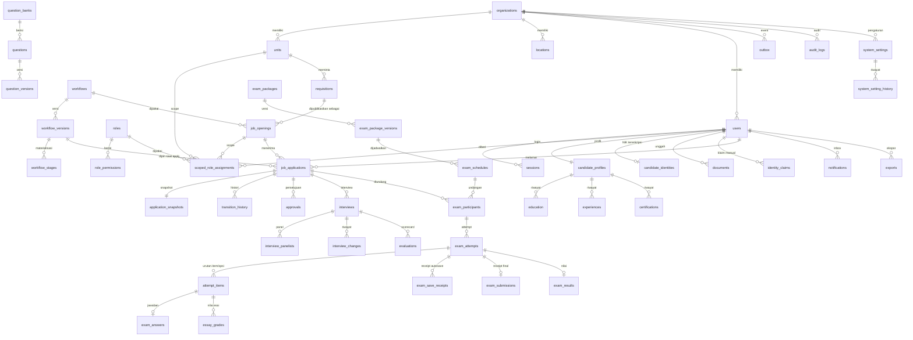

# ERD dan Kamus Data

Sumber kebenaran skema: `backend/db/migrations/*.up.sql` (versi 6). Diagram ini merangkum relasi utama; kolom audit (`created_at`, `updated_at`, `version`) tidak semuanya ditampilkan.

## Kamus kolom penting

| Tabel.kolom | Tipe | Makna / aturan |
|---|---|---|
| `users.kind` | text | `staff` atau `candidate`; email unik per organisasi (`lower`). |
| `users.password_hash` | text | Argon2id m=19 MiB, t=2, p=1. Tidak pernah diserialisasi ke JSON. |
| `sessions.token_digest` | bytea | SHA-256 token cookie; token mentah hanya di browser. `idle_expires_at`, `absolute_expires_at`, `revoked_at`. |
| `scoped_role_assignments.unit_id / job_id` | uuid null | Keduanya null = seluruh organisasi; `job_id` membatasi ke satu lowongan. `revoked_at` mencabut pada request berikutnya. |
| `candidate_identities.nik_ciphertext / nik_nonce / key_version` | bytea, int | AES-256-GCM, nonce 12 byte acak per baris, AAD = org. |
| `candidate_identities.nik_blind_index` | bytea(32) | HMAC-SHA256 kunci terpisah; `UNIQUE(org_id, nik_blind_index)` = satu master per NIK. |
| `candidate_identities.nik_last4` | text | Untuk tampilan tersamar. |
| `job_applications.workflow_version_id, stage_key` | uuid, text | Versi workflow dipin saat apply; FK komposit ke `workflow_stages`. `UNIQUE(job_id, candidate_user_id)`. |
| `job_applications.applied_at / stage_entered_at` | timestamptz | Terpisah untuk metrik waktu per tahap. |
| `application_snapshots.profile` | jsonb | Salinan profil saat melamar; trigger menolak UPDATE/DELETE. |
| `transition_history.execution_id` | uuid unik | Event/perintah duplikat menjadi no-op. Append-only. `rule_ref` = edge, rule, versi; `input_summary` = fakta allowlist tanpa PII. |
| `workflow_versions.definition` | jsonb | Graph immutable (trigger). `workflows.draft_definition` dapat diubah. |
| `exam_attempts.seed / algo_version` | bytea, int | Seed privat + versi algoritma pengacakan; tidak pernah dikirim ke klien. |
| `exam_attempts.started_at / deadline_at` | timestamptz | Dari jam DB, termasuk akomodasi, dibatasi penutupan jadwal. |
| `exam_attempts.revision` | bigint | Naik satu per batch commit; = jumlah `exam_save_receipts` attempt. |
| `attempt_items.option_map` | jsonb | ID opsi opaque per attempt -> ID opsi asli; kunci jawaban tidak ikut ke peserta. |
| `exam_answers.revision` | int | Revisi per butir; `baseRevision` basi -> 409 dengan state server. |
| `exam_save_receipts.response` | bytea | Byte ACK persis; retry `op_id` sama mengembalikan byte yang sama. |
| `exam_submissions.answers_digest` | bytea | `sha256(snapshot::jsonb::text)` dihitung PostgreSQL; dapat diverifikasi ulang. Satu baris per attempt (PK). |
| `interview_panelists.period` | tstzrange | Exclusion constraint GiST mencegah bentrok jadwal interviewer aktif. |
| `outbox.status / attempts / available_at / locked_until` | | `pending/done/dead`, backoff + jitter, lease klaim. Indeks parsial `WHERE status='pending'`. |
| `processed_events(consumer, event_id)` | | Dedup per consumer. |
| `audit_logs` | | Actor, action, target, scope unit, outcome, reason, request ID, detail. Append-only (trigger). |
| `idempotency_keys` | | Scope aktor + operasi + resource + key; digest payload + respons disimpan di transaksi yang sama. |

## Kebijakan penghapusan

FK histori penting memakai `ON DELETE RESTRICT`. Tabel bukti (`audit_logs`, `transition_history`, `application_snapshots`, `workflow_versions`, `question_versions`, `exam_package_versions`, `exam_submissions`, `essay_grades`, `interview_changes`, `system_setting_history`) menolak UPDATE/DELETE lewat trigger `forbid_mutation`. Penghapusan data pribadi atas permintaan subjek data mengikuti prosedur di `docs/product/privacy.md` (anonimisasi kolom identitas, bukan penghapusan baris bukti), dan menunggu keputusan pemilik kebijakan.

## Indeks akses utama

`(job_id, stage_key, applied_at, id)`, `(candidate_user_id, applied_at, id)`, `(org_id, unit_id, applied_at desc, id desc)`, `(schedule_id, status)`, `UNIQUE(attempt_id, item_id)` (PK), outbox pending parsial, `exam_attempts(deadline_at) WHERE status='in_progress'` untuk worker expiry, `audit_logs(org_id, created_at desc, id desc)`. Daftar besar memakai keyset pagination dengan tie-breaker ID.
